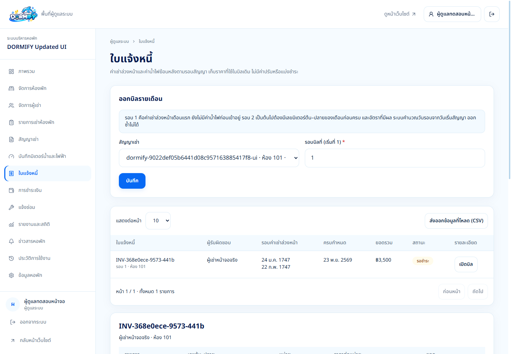

# คู่มือ Admin DORMIFY

ติดตั้งตาม [คู่มือเครื่องใหม่](SETUP_NEW_MACHINE.md) สร้าง Admin ด้วย `npm.cmd --prefix server run admin:create` ไม่สมัคร Admin ผ่านหน้าเว็บและไม่มีรหัสผ่านเริ่มต้น

## เตรียมข้อมูลหอ

1. **ข้อมูลหอพัก** บันทึกชื่อ ที่อยู่ จังหวัด และข้อกำหนดของหอเดียว หากมีหอแล้วให้แก้ข้อมูลเดิม
2. ตั้งนโยบายกันห้อง 72 ชั่วโมง เงินประกัน 1 เดือน ครบกำหนด 5 วัน หรือค่าที่เจ้าของยืนยัน การเปลี่ยนใช้กับรายการใหม่ ไม่แก้ Snapshot เดิม
3. **จัดการห้องพัก** เพิ่มเลขห้อง ประเภทห้อง ราคา จำนวนผู้พัก และรูปจริง เปิด/ปิดให้บริการได้เมื่อไม่มีคำขอหรือการครอบครองที่ต้องจัดการก่อน
4. **บันทึกมิเตอร์น้ำและไฟฟ้า** บันทึกอัตรา วันเริ่มใช้ และที่มา ใช้อัตราที่เจ้าของตรวจสอบแล้ว ไม่ใช้ค่าจำลองกับผู้เช่าจริง

## รับผู้เช่าและทำสัญญา

1. ให้ผู้รับผิดชอบสมัคร USER ก่อน ตรวจคำขอใน **รายการเช่าห้องพัก** แล้วอนุมัติ/ไม่อนุมัติ/ยกเลิกตามกรณี
2. เมื่ออนุมัติ ห้องถูกกันชั่วคราวตาม Snapshot การอนุมัติไม่ใช่สัญญาเช่า
3. **จัดการผู้เช่า** เพิ่มทะเบียนที่ผูกกับบัญชี USER ระบุผู้รับผิดชอบหลักหนึ่งคน
4. **สัญญาเช่า** เพิ่มร่าง เลขสัญญา ห้อง ผู้เช่า วันเริ่ม ค่าเช่าตามสัญญา ประกัน และรายชื่อผู้พักร่วม
5. ลงนามจริงแล้วจึงบันทึกวันลงนามและกดเริ่มใช้สัญญา ห้ามเปิดใช้สองสัญญาทับห้องเดียว แก้ราคาในร่างก่อนเริ่มใช้

## รอบบิลและรับเงิน

ภาพจาก Browser test วันที่ 18 พฤศจิกายน 2026 ชื่อ/เลขสัญญา/วันที่เป็น Fixture ทดสอบ ไม่ใช่ผู้เช่าหรือรายการรับเงินจริง

1. บันทึกมิเตอร์ต้นสัญญาของทั้งน้ำและไฟ เก็บเลขจริงถึงวันรอบบิลและทุกวันเปลี่ยนอัตรา
2. ออก **ใบแจ้งหนี้** รอบ 1 เป็นค่าเช่าล่วงหน้าล้วน รอบ 2 รวมค่าเช่าล่วงหน้ากับน้ำไฟรอบก่อน ไม่มีวันที่ในเดือนให้ใช้วันสุดท้ายของเดือน
3. ตรวจบิลก่อนแจ้งผู้เช่า ไม่ออกซ้ำ ถ้าจะเปิดออกบิลอัตโนมัติ ต้องเตรียมอัตรา/มิเตอร์และเปิดนโยบายก่อน Backend ต้องทำงานอยู่
4. **การชำระเงิน** บันทึกรับเงินสด หรือเปิดหลักฐานโอน ตรวจยอดจริงแล้วจึงยืนยัน รายการรอตรวจไม่ถือเป็นรายรับ ปฏิเสธพร้อมเหตุผลเมื่อไม่ถูกต้อง
5. บันทึกเงินประกันแยกจากค่าเช่า คืนประกันหลังจบสัญญาตามยอดที่รับจริง ไม่ใช้ยอดประกันหักบิลอัตโนมัติ
6. ปรับบิลผ่านใบปรับยอด เลือกค่าเช่า/น้ำ/ไฟ ระบุยอดและเหตุผล บิลเดิมไม่ถูกทับ ใบลดหนี้ก่อนชำระไม่เปิดให้คืนเงินจริงซ้ำ

## ปิดสัญญาและคืนเงิน

1. ตรวจรายการชำระที่ค้างตรวจให้จบ บันทึกมิเตอร์จริงถึงวันออก
2. กด **ปิดยอดและจบสัญญา** ระบุวันออกและเหตุผล ค่าเช่าคิดวันเริ่มรวม วันออกไม่รวม ส่วนลดค่าเช่าเฉลี่ยตามวันใช้จริงในแต่ละรอบ
3. หากใบปรับน้ำไฟคร่อมวันออก ฟอร์มจะให้ระบุยอดลด/เพิ่มที่ใช้จริง (กรอกจำนวนบวกหรือศูนย์) เหตุผล และหลักฐาน เช่น วัน/เลขอ่านมิเตอร์ กดคำนวณตัวอย่างใหม่ ห้ามกรอกเกินยอดรายการเดิมหรือใช้ส่วนลดเกินค่าใช้จ่ายจริง
4. ตรวจยอดและรายละเอียดทั้งหมดก่อนยืนยัน ระบบเก็บ Snapshot ห้องจึงกลับว่าง การปิดยอดยังไม่ถือว่ารับ/คืนเงินสดแล้ว
5. บันทึกรับเพิ่ม/คืนเต็มยอดที่ **บันทึกรับหรือคืนเงินจริงตามยอดปิดสัญญา** แล้วคืนเงินประกันแยก บันทึกเฉพาะเมื่อมีเงินจริงเคลื่อนย้าย
6. ต่ออายุหรือย้ายห้องให้สร้างสัญญาฉบับถัดไป ไม่เขียนทับสัญญาและบิลเก่า

## งานประจำอื่น

- แจ้งซ่อม: เปลี่ยนสถานะและระบุผล ผู้เช่าจะเห็นความคืบหน้า
- รายงาน: บันทึกรายจ่ายและกรองวันที่ ยอดรายรับใช้รายการยืนยันจริง เงินประกันแยกต่างหาก
- ข่าวสาร: เพิ่ม/แก้ประกาศ ไม่ใส่ข้อมูลส่วนบุคคลลงข่าวส่วนกลาง
- ประวัติ: ค้นหาผู้ทำ/รายการ/วันที่ ใช้ Export CSV เพื่อส่งออกทุกหน้าตามตัวกรอง
- ห้าม Reset/Seed หรือ `docker compose down -v` บนเครื่องที่มีข้อมูล ปิดระบบก่อนทดสอบ API/UI ตามคู่มือ บัญชี/ฐานข้อมูลไม่ถูกส่งผ่าน Git
