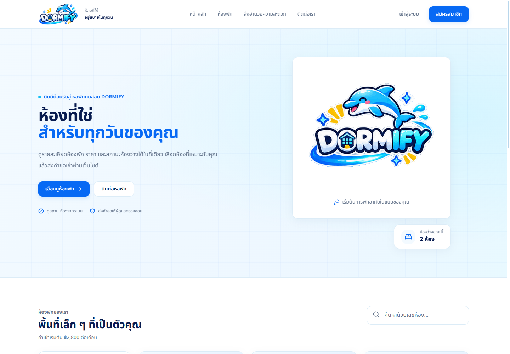

# คู่มือผู้ใช้ DORMIFY

สำหรับระบบ Local และบัญชี USER เท่านั้น ใช้ URL ที่ผู้ดูแลแจ้ง เครื่องปัจจุบันคือ http://127.0.0.1:5173

ภาพจาก Browser test วันที่ 18 พฤศจิกายน 2026 ใช้ข้อมูล Fixture ที่สร้างเพื่อทดสอบและลบแล้ว ไม่ใช่ข้อมูลหอหรือจำนวนห้องจริง

## เริ่มเช่า

1. เปิดหน้าแรก เลือกห้อง อ่านราคา สิ่งอำนวยความสะดวก และข้อกำหนดการอยู่อาศัย
2. สมัครสมาชิกด้วยอีเมลที่ไม่ซ้ำ จากนั้นเข้าสู่ระบบ บัญชีสมัครทั่วไปเป็น USER เสมอ
3. เปิดรายละเอียดห้อง กรอกวันที่ในฟอร์มคำขอแล้วส่ง การส่งคำขอยังไม่ใช่การทำสัญญาหรือยืนยันว่าได้ห้อง
4. ดูผลที่ **สถานะการเช่า** เมื่อ Admin อนุมัติห้องจะถูกกันตามเวลาที่บันทึกไว้ เริ่มต้น 72 ชั่วโมง ติดต่อเจ้าของหอก่อนหมดเวลา
5. ตกลงรายละเอียดและลงนามกับเจ้าของหอ เมื่อ Admin บันทึกและเริ่มสัญญาแล้วจึงดูข้อมูลที่ **สัญญาเช่า** และ **ข้อมูลห้องพัก**

## บิลและการชำระเงิน

- ดูรายการค่าใช้จ่าย วันครบกำหนด และยอดรวมที่ **ใบแจ้งหนี้** ค่าเช่าล่วงหน้า น้ำไฟย้อนหลังตามมิเตอร์
- ที่ **การชำระเงิน** เลือกบิลเต็มยอดและวิธีชำระ กรณีโอนให้แนบภาพ PNG/JPEG ไม่เกิน 2 MB หลังส่งรายการ การแนบภาพยังไม่ใช่การยืนยันว่าได้รับเงิน
- ชำระตามช่องทางที่ตกลงกับเจ้าของหอ ไม่สมมติหมายเลขบัญชีจากเว็บนี้ หากต้องแก้รายการที่ถูกปฏิเสธ ให้อ่านเหตุผลและส่งรายการใหม่ตามคำแนะนำผู้ดูแล
- รอ Admin ตรวจ ดูผลที่ **ประวัติการชำระเงิน** ระบบไม่รองรับแบ่งชำระและไม่มีค่าปรับล่าช้า

## แจ้งซ่อม ข่าวสาร และย้ายออก

- ที่ **แจ้งซ่อม** เลือกสัญญาของตนที่ใช้งานอยู่ ระบุหัวข้อและอาการ แล้วติดตามสถานะ รอดำเนินการ/กำลังดำเนินการ/ซ่อมเสร็จ
- ที่ **การแจ้งเตือน** อ่านข่าวส่วนกลางและรายการเฉพาะตน แล้วกดทำเครื่องหมายว่าอ่านแล้ว
- เมื่อต้องย้ายออก ติดต่อ Admin เพื่อตรวจมิเตอร์และปิดยอด ระบบคิดรวมวันเริ่ม ไม่รวมวันออก และแสดงรับเพิ่ม/คืนเงินจริงแยกจากเงินประกัน
- ออกจากระบบหลังใช้เครื่องร่วมกับผู้อื่น หน้าโปรไฟล์ในขอบเขตนี้ใช้ดูข้อมูล ไม่รับรองว่ามีฟังก์ชันแก้ข้อมูลหรือเปลี่ยนรหัสผ่านด้วยตนเอง

## ปัญหาที่พบบ่อย

- เข้าสู่ระบบไม่ได้: ตรวจอีเมลและรหัสผ่าน ติดต่อผู้ดูแล ไม่ส่งรหัสผ่านในแชทหรือรายงานปัญหา
- ไม่พบข้อมูลสัญญา/บิล: ต้องมีสัญญาที่ Admin ผูกกับบัญชีนี้ ไม่ใช่เพียงมีคำขอเช่า
- เชื่อมต่อไม่ได้: ให้ผู้ดูแลตรวจ Frontend, API และ Docker ไม่ใช้การสมัครซ้ำแก้ปัญหาฐานข้อมูล
