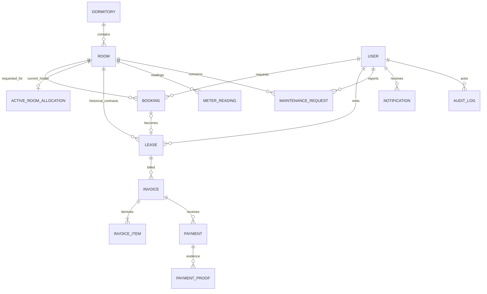

# แผน TypeScript, MySQL และแบบข้อมูลเชิงแนวคิด

> สถานะ 13 พฤศจิกายน 2026: ย้ายเจ็ด Models เดิมไป MySQL 8.4.13 ผ่าน Docker แล้ว พร้อม Migration/Setup และทดสอบจริง ดู [สถานะปัจจุบัน](../PROJECT_STATUS.md) และ [คู่มือเครื่องใหม่](../SETUP_NEW_MACHINE.md) เนื้อหาด้านล่างเป็นแผนเดิมและแบบข้อมูลอนาคต ข้อความว่าไม่มี migrations/ยังไม่ได้ย้ายไม่ใช่สถานะล่าสุด

> อัปเดตตามคำขอล่าสุด: ใช้ MySQL ฐานหลักเดียวชื่อ dormify ไม่แยก dormify_dev/dormify_test; ดู [รายการเตรียมฐานข้อมูล](../DATABASE_PREPARATION.md)

> ปรับบริบท 13 พฤศจิกายน 2569: ดู [แบบข้อมูลตาม Business Rules ล่าสุด](PHASE1_BUSINESS_RULES_DESIGN.md)
> ก่อนใช้ Models/Workflow ในเอกสารเดิมนี้ โดยเฉพาะผู้พักร่วม การกันห้องหมดอายุ เงินประกันแยกหมวด
> BillingCycle ตามวันเริ่มสัญญาเป็นแนวทางเสนอในข้อ 9 ที่ยังรอเจ้าของหอยืนยัน; หนึ่ง Settlement เต็มยอดต่อบิล ไม่มีการแบ่งชำระ ตามข้อ 12
> ข้อ 3, 6 และ 9 ทั้งแนวทาง รวมค่า 72 ชั่วโมง/ประกัน 1 เดือน/Due 5 วันยังเป็นข้อเสนอ ไม่ใช่นโยบายที่ยืนยันแล้ว
> ข้อความต้นทางล่าสุด: [กติกาการทำงานของระบบ 14 ข้อ](../BUSINESS_RULES.md)

เอกสารนี้เป็นข้อเสนอสำหรับอนุมัติ ไม่มีการเปลี่ยน Schema สร้าง MySQL ติดตั้ง Dependencies หรือย้ายข้อมูลในงานนี้
ขอบเขตที่ยึดถือ: Frontend React/Vite/TypeScript, Backend Node/Express, MySQL, Prisma, Tailwind, Local และเพียง ADMIN/USER

## 1. ขั้นตอนเตรียม MySQL แบบไม่ทำลาย SQLite

1. ยืนยัน D01–D12 และเลือก MySQL รุ่นที่เข้ากับ Prisma/Node ที่จะตรึงจริงก่อนติดตั้ง ไม่ถือว่าเอกสารรุ่นล่าสุดใช้กับ Prisma 5 ได้ทุกคำสั่ง
2. ตรวจ Installation/Service/Port จริง ปัจจุบันไม่พบ mysql/mysqld/mysqldump ใน PATH เท่านั้น ยังสรุปว่าเครื่องไม่มี MySQL ไม่ได้
3. สำรอง SQLite และไฟล์แนบพร้อม Hash/จำนวนแถว ก่อนเปลี่ยน Environment; ตรวจว่า App ปิดการเขียนขณะ Snapshot หรือใช้วิธี Backup ที่สอดคล้องกับ SQLite
4. สร้าง MySQL ฐานหลักเดียวชื่อ dormify หลังได้รับคำสั่ง ใช้ InnoDB/utf8mb4 และเลือก Collation ตามความต้องการ Email/Room Number ไม่สร้างฐาน Dev/Test ถาวรเพิ่มเอง
5. Bind MySQL loopback; แยก DB User ของ App ออกจาก root และบัญชี Migration; App มีสิทธิ์เฉพาะ DB ที่จำเป็น ไม่ให้สร้าง/ลบ Database
6. เตรียม DATABASE_URL แบบ mysql ใน server/.env ที่ Ignore โดย Escape ส่วน Username/Password ที่มีอักขระพิเศษ เก็บ .env.example เป็น Placeholder ห้ามใส่รหัสจริงใน URL ตัวอย่าง
7. จัด Schema สำหรับ Provider MySQL และ Native Types ที่ตรวจแล้วบน Branch/สำเนาพัฒนา ไม่สลับ Provider แล้วรันกับ SQLite เดิม
8. สร้าง Initial Migration ของ MySQL บนฐานว่าง ตรวจ Generated SQL ก่อน Apply; ไม่ใช้ db push เป็นประวัติ Migration ระยะยาว และไม่ใช้ Reset/accept-data-loss เพื่อผ่าน Error
9. ย้ายข้อมูลด้วย ETL ที่อ่าน SQLite แบบ Read-only และเขียน Target แบบ Transaction/Batch มี ID Mapping และตรวจซ้ำได้ ห้าม Import SQLite SQL dump เข้า MySQL ตรง ๆ
10. ตรวจ Counts, FK, Unique, Thai text, Hash รหัสผ่าน, Precision เงิน และวันเวลาเทียบก่อน–หลัง เก็บผล Reconciliation โดยไม่เปิดเผยข้อมูลบุคคล
11. กำหนดวิธีทดสอบ MySQL จริงที่ไม่ทำลายข้อมูลในฐานเดียว ไม่ Reset/Seed ฐานใช้งาน และไม่สร้างฐานทดสอบถาวรเพิ่มเอง; ผลจาก SQLite ยังคงเป็นหลักฐานเฉพาะ SQLite
12. Cutover หลังผ่านเกณฑ์และอนุมัติเท่านั้น เก็บ SQLite เดิมโดยไม่แก้/ลบ หากไม่มีข้อมูลจริง ณ เวลาย้าย ให้บันทึกว่ามี 0 แถวและทดสอบ Migration ด้วยข้อมูลทดสอบที่ได้รับอนุญาตแทนการแต่งผล

Prisma migrations ผูก SQL กับ Provider; แนวคิดการเก็บไฟล์ Migration/แก้ SQL ดู [Prisma Migrate overview รุ่น v6](https://www.prisma.io/docs/orm/v6/prisma-migrate/understanding-prisma-migrate/overview)
แหล่งนี้อธิบายแนวคิด ไม่ใช่การสั่งอัปเกรดจาก Prisma 5 เป็น 6; ต้องตรวจคำสั่ง/Support Matrix ของรุ่นที่อนุมัติก่อนลงมือ
โปรเจกต์ปัจจุบันยังไม่มี migrations จึงเริ่มประวัติ MySQL แยกใหม่ โดยเก็บ Schema/SQLite เดิมเป็นหลักฐาน

## 2. แผน Rollback และการทดสอบข้อมูล

ก่อน Cutover กำหนดช่วงหยุดเขียนและจุด Restore ของ Code/.env/DB/Uploads ที่สอดคล้องกัน
หาก MySQL ยังไม่รับรายการใหม่ สามารถกลับ Code/Environment ชุด SQLite ที่สำรองไว้แล้วตรวจ Read/Write ได้
หาก MySQL รับรายการใหม่แล้ว ห้ามสลับกลับ SQLite เก่าทันที เพราะรายการใหม่จะหายจากมุมมองระบบ
ต้อง Freeze Writes, Export Delta/กระทบยอด หรือ Restore MySQL Snapshot ตามแผนที่ตกลงและตรวจครบก่อนเปิดใหม่
ไม่ลบ MySQL หรือ SQLite เพื่อ Rollback และไม่ใช้ Git reset ทำลายงานที่ยังไม่ Commit

เกณฑ์ข้อมูล: จำนวนแถวตรงตาม Mapping, ไม่มี FK หลุด, เลขห้อง/Email ซ้ำถูกแก้โดยผู้รับผิดชอบก่อนบังคับ Unique
ยอดเงินรวมและรายละเอียดบิลต้องตรงถึงสตางค์; ตัวอักษรไทยไม่เพี้ยน; Password Hash เดิมยัง Login ได้; วันเวลาแสดง Asia/Bangkok ถูกต้อง
Role Mapping: TENANT → USER เป็นข้อเสนอ; OWNER ต้องตรวจทีละบัญชี ไม่ยก OWNER ทุกคนเป็น ADMIN อัตโนมัติ
หากมีหลาย Property จริงต้องยืนยันหอที่จะใช้และเก็บที่เหลือโดยไม่ลบทิ้ง

## 3. TypeScript แบบค่อยเป็นค่อยไป

เริ่ม Frontend ตาม PDF เท่านั้น ไม่เปลี่ยน CommonJS Server เป็น TypeScript/ESM พร้อมกันโดยไม่มีเหตุผล
ใช้ `allowJs` ชั่วคราวเพื่อให้ JS เดิมอยู่ร่วมกับ TS แล้วทยอยเพิ่ม Types ตาม [คู่มือ TypeScript migration](https://www.typescriptlang.org/docs/handbook/migrating-from-javascript.html)

ลำดับเสนอ: tsconfig/vite-env → types ของ Role/User/Room/Booking/API errors → API Client → AuthContext/Route Guard → Components → Pages → main/App
ไฟล์ React ใช้ .tsx, utility/API ใช้ .ts และปรับ Import ทุกแห่ง; ภายหลังค่อยปิด allowJs เมื่อย้ายครบ
กำหนด Role union ADMIN/USER ฝั่ง UI แต่ Backend ต้อง Allowlist/Authorize จริง ไม่ใช้ TypeScript แทน Runtime Validation
API DTO ต้องนิยาม Decimal เป็น String หรือรูปแบบเงินที่ตกลง และ ISO Date เป็น String ไม่สับสนกับ Date object
รับ Response ที่อาจ null/404/error โดยไม่ใช้ any หรือ Non-null assertion กลบปัญหาทั้งระบบ
แยกงานเปลี่ยนชื่อไฟล์กับงานเปลี่ยน Business Logic เพื่อให้ Review/ย้อนกลับได้ง่าย

ไฟล์คาดว่าจะเพิ่ม/แก้ในอนาคต: client/tsconfig*.json, client/src/vite-env.d.ts,
client/src/types/*.ts, client/src/services/api.ts, client/src/**/*.tsx, client/package*.json และ vite.config.ts ถ้าเลือกย้าย Config
ยังคง Vite/React/Tailwind ไม่เปลี่ยนเป็น Framework อื่น
เกณฑ์ผ่าน: Typecheck ไม่มี Emit, Build ผ่าน, Route/Forms/Token Errors ไม่ถดถอย และ Browser Tests ยืนยันข้อมูลจาก DB จริง

## 4. Models เป้าหมายที่เสนอ

ชื่อ/Fields เป็นแบบแนวคิดเพื่อทบทวน ไม่ใช่ Prisma Schema ใหม่ที่ได้สร้างแล้ว
TenantProfile เป็นข้อมูลประกอบ User ไม่ใช่ Role เพิ่ม; เจ้าของหอทำงานผ่าน ADMIN ไม่มี OWNER/STAFF ในเป้าหมาย

| Model | หน้าที่และข้อมูลสำคัญ | ความสัมพันธ์/ข้อบังคับที่เสนอ | Requirement |
|---|---|---|---|
| User | Email Hash ชื่อ Role สถานะบัญชี | Email normalized unique; Role ADMIN/USER เท่านั้น | 1.1, 2.1, 2.6 |
| TenantProfile | ข้อมูลผู้เช่า/ติดต่อที่ต้องใช้จริง | userId unique เมื่อมีบัญชี; หลีกเลี่ยงเก็บเอกสารส่วนตัวเกินจำเป็น; วิธีผูกผู้เช่าเดิมรอยืนยัน | 1.3–1.4, 2.6 |
| Dormitory | ข้อมูลหอเดียว ที่อยู่ กฎ ติดต่อ | จำกัดหนึ่ง Record ที่ Service/Constraint ที่ตรวจได้ | 2.2 |
| Amenity / DormitoryAmenity | สิ่งอำนวยความสะดวกจริง | ชื่อ/ความสัมพันธ์ไม่ซ้ำ ไม่อ่าน Mock | 2.2 |
| Room / RoomImage | ห้อง ประเภท ราคา รูป สถานะใช้งาน | roomNumber unique ในหอเดียว; ราคาไม่ติดลบ; ปิดห้องแทนลบประวัติ | 1.2, 2.3 |
| Booking | คำขอเช่าของ User วันที่และ State | userId/roomId FK, status/createdAt/reviewedAt; FK ไม่อาศัย Mock ID | 1.5, 2.4–2.5 |
| ActiveRoomAllocation | สิทธิ์ครอบครองห้องปัจจุบัน | roomId PK/unique; สถานะ RESERVED/OCCUPIED; FK Booking/Lease ตาม State | 1.5, 2.3–2.5 |
| Lease | สัญญาและการเข้าพักจริง | contractNo unique; roomId/userId FK; bookingId unique ถ้ามี; Rent/Deposit snapshot | 1.3–1.6, 2.5–2.7 |
| RateSetting | อัตราน้ำไฟและวันมีผล | ไม่แก้ค่าเดิมเพื่อเปลี่ยนบิลย้อนหลัง; ค่า Snapshot ที่ Reading/InvoiceItem | 1.7–1.8 |
| MeterReading | ค่าก่อน/หลัง หน่วย รอบห้อง | unique roomId+period+utilityType; ตรวจค่าลดลงและการเปลี่ยนมิเตอร์ตามนโยบาย | 1.7–1.8, 2.8 |
| Invoice / InvoiceItem | หนี้รายเดือนและรายละเอียด | invoiceNo unique; leaseId+period+invoiceType unique ตามกติกา; Line totals/snapshot | 1.8, 2.8 |
| Payment | แจ้ง/ตรวจรับเงิน/เหตุผลปฏิเสธ | invoiceId/userId/verifiedBy FK; amount/date/status; กัน Verify ซ้ำ | 1.9, 2.9–2.10 |
| PaymentProof | Metadata ของไฟล์ส่วนตัว | paymentId FK; storageKey/hash/mime/size; ไม่เปิด Public URL | 1.9, 2.9 |
| MaintenanceRequest | เรื่องซ่อม ผู้แจ้ง ห้อง สถานะ | userId/roomId/leaseId ตามเวลาที่แจ้ง; ประวัติ Status/ผู้ดำเนินการ | 1.10, 2.11 |
| Expense | รายจ่ายจริงตามช่วงเวลา | amount/date/category/reference/ผู้บันทึก; การแก้/ยกเลิกต้อง Audit | 1.11 |
| Announcement | ข่าวสารหอพัก | ข้อความ/ช่วงเผยแพร่/ผู้ประกาศ; Admin จัดการ User อ่าน | 2.12 |
| Notification | รายการสำคัญเฉพาะ User | recipientId+eventKey กันซ้ำ, readAt; ไม่เผยแพร่ยอด/สัญญาของผู้อื่น | 2.12 |
| AuditLog | ประวัติงานสำคัญ | actor/action/entity/id/time/ผล; ไม่เก็บ Password/Token/ไฟล์หลักฐานดิบ | 1.13 |

Payment เดิมผูก Booking ต้องย้ายไป Invoice ตามวงจรค่าเช่ารายเดือน ไม่เปลี่ยน Relation เฉย ๆ จนข้อมูลเดิมหลุด
Complaint เดิมผูก Property ต้องเพิ่ม Room/Lease Context หรือย้ายเป็น MaintenanceRequest โดยมี Mapping ไม่สร้างสองระบบซ่อมซ้ำซ้อน
Expense/Announcement เป็นรายละเอียดรองรับรายงาน/ข่าวสารที่ PDF ต้องการ แต่ฟอร์ม/สิทธิ์จัดการย่อยต้องยืนยัน D09/D10 ก่อนสร้าง

## 5. ความสัมพันธ์หลัก

Diagram แสดงแกนหลักเท่านั้น Expense/Announcement/Amenity อยู่ในตาราง Models ด้วย ไม่ได้ตัดข้อกำหนดออก
Optional actor ของ Audit และผู้เช่าที่ไม่มี Account ต้องตัดสินใจก่อน Final ER Diagram

## 6. ป้องกันเช่าซ้ำและ State Machine

เสนอ Booking REQUESTED → APPROVED/REJECTED/CANCELLED และ Lease DRAFT → ACTIVE → ENDED
ชื่อ State จริงและ EXPIRED/วันนัดต้องอนุมัติ D05/D06; คำว่า User ยืนยันไม่ควรตีความว่าทำสัญญาเสร็จแล้ว
จุดกันห้องตามคำขอปัจจุบันอยู่หลัง Admin ยืนยัน หากให้ PENDING หลายรายการได้ ต้องแสดงว่าห้องยังไม่ถูกกันจนถึงจุดนี้

เมื่อ Admin ยืนยัน ให้ Lock Room เดียวกันใน Transaction แล้วตรวจ Room ใช้งานได้/Booking ของห้อง/State/ActiveRoomAllocation
ถ้ายังไม่มี Allocation จึงสร้างด้วย roomId unique แล้วเปลี่ยน Booking และบันทึก Audit พร้อมกัน
ถ้ามี Allocation ของรายการอื่นให้ 409 Conflict; หาก Retry รายการเดิมให้ตอบผลเดิม ไม่สร้างซ้ำ
ตอนเปิด Lease ต้องย้าย Allocation จากการกันไปเป็นเข้าพักใน Transaction โดยไม่เปิดช่องให้ห้องว่างกลางทาง
เมื่อ Cancel/End ให้ปลดเฉพาะ Allocation ที่เป็นของ Booking/Lease นั้น ไม่สั่ง isAvailable=true โดยไม่ดูผู้ครอบครอง
เก็บ Booking/Lease/Audit เป็นประวัติ แม้ Active allocation จะสิ้นสุด ไม่ลบประวัติการเงิน/สัญญา

การอ่านแล้วอัปเดตโดยไม่มี Lock อาจไม่พอ ตาม [MySQL InnoDB locking reads](https://dev.mysql.com/doc/refman/26.10/en/innodb-locking-reads.html)
แนวคิดนี้ต้องนำไปตรวจกับ MySQL รุ่นที่จะใช้จริงและ Parameterized Query ที่ Prisma รุ่นนั้นรองรับ
Constraint เป็นแนวป้องกันเพิ่ม ไม่อ้างว่า Unique(roomId,status) ป้องกันหลาย Active States หรือช่วงเวลาทับกันได้
ถ้าอนุมัติการจองล่วงหน้าหลายช่วงเวลา ต้องออกแบบ Interval overlap ภายใต้ Room lock เพิ่ม ไม่ใช้แผน Active หนึ่งรายการแบบนี้โดยอัตโนมัติ
ถ้าเช่าแยกเตียง ต้องเปลี่ยน Allocation ไปที่ Bed ตาม D07 ก่อนดำเนินการ

Acceptance: ส่งสองคำขอยืนยันห้องเดียวกันพร้อมกันได้เพียงผู้ถือสิทธิ์เดียว, Confirm ซ้ำได้ผลเดิม,
Cancel ของคนอื่นถูกปฏิเสธ, Cancel รายการเก่าไม่ปลดผู้ถือสิทธิ์ใหม่, Restart แล้วยังกันห้องอยู่
ต้องรันบน MySQL จริงในฐานทดสอบที่อนุญาต ไม่ใช้ SQLite ผ่านแทน

## 7. เงิน มิเตอร์ และรายงาน

เสนอ Decimal precision ชัดเจน เช่น Decimal(12,2) สำหรับยอดเงิน โดยยืนยันเพดาน/การปัดเศษก่อนใช้จริง
ห้าม Number float รวมเงินแบบไม่มีกติกา; คำนวณฝั่ง Server และใช้ Decimal/สตางค์ตามมาตรฐานเดียว
เก็บหน่วยน้ำไฟ อัตรา และค่าเช่าตอนออกบิลเป็น Snapshot ไม่คำนวณบิลเก่าจากราคา Room ล่าสุด
Payment ที่ส่งหลักฐานยังไม่ถือเป็นรายรับ จน Admin ยืนยันตามนโยบาย; กำหนดกรณีชำระบางส่วน/เกิน/ยกเลิกก่อนทำ
Report รายรับดึง Verified payments ส่วน Invoice คือยอดเรียกเก็บ แสดงแยกกัน; รายจ่ายดึง Expense ไม่ใช้ค่าซ่อมที่ยังไม่จ่ายแทนโดยไม่แจ้ง
Audit เก็บการออกบิล/แก้ข้อมูล/ตรวจรับเงินตั้งแต่ Phase ที่สร้าง ไม่รอ Dashboard Phase 8 ค่อยเริ่มเก็บย้อนหลัง

## 8. แผนอัปโหลดหลักฐานและการเข้าถึง

ยืนยันชนิดไฟล์/เพดานก่อนพัฒนา เริ่ม Allowlist ที่จำเป็น ไม่รับทุก Extension
ตรวจ Extension + MIME + File signature/การ Decode ที่เหมาะสม; ห้ามเชื่อ MIME จาก Browser อย่างเดียว
ตั้งชื่อสุ่มฝั่ง Server ไม่ใช้ Filename เป็น Path จำกัดขนาด/จำนวน/ความถี่ ป้องกัน Traversal และไฟล์ Active content
เก็บนอก public/static หรือ Web root; GET Download ตรวจ Admin/เจ้าของ Payment ทุกครั้ง
ตอบ Content-Type/Disposition ที่ปลอดภัย ไม่เปิด SVG/HTML/Executable แบบ Inline
เก็บ Metadata/Hash ใน DB และออกแบบ Cleanup ของไฟล์ที่ DB commit ไม่สำเร็จ ไม่ปล่อยไฟล์กำพร้าหรือเปิดช่อง Upload ก่อนตรวจสิทธิ์
อัปโหลดไม่เปลี่ยน Invoice เป็น PAID เอง ต้องผ่าน Admin Verify และ Transaction/Idempotency
แนวปฏิบัติอ้างอิง [OWASP File Upload Cheat Sheet](https://cheatsheetseries.owasp.org/cheatsheets/File_Upload_Cheat_Sheet.html)
Tests: file ปลอม Extension, MIME mismatch, oversize, path traversal, unauthenticated, User A อ่าน Proof ของ B และ Verify ซ้ำ
