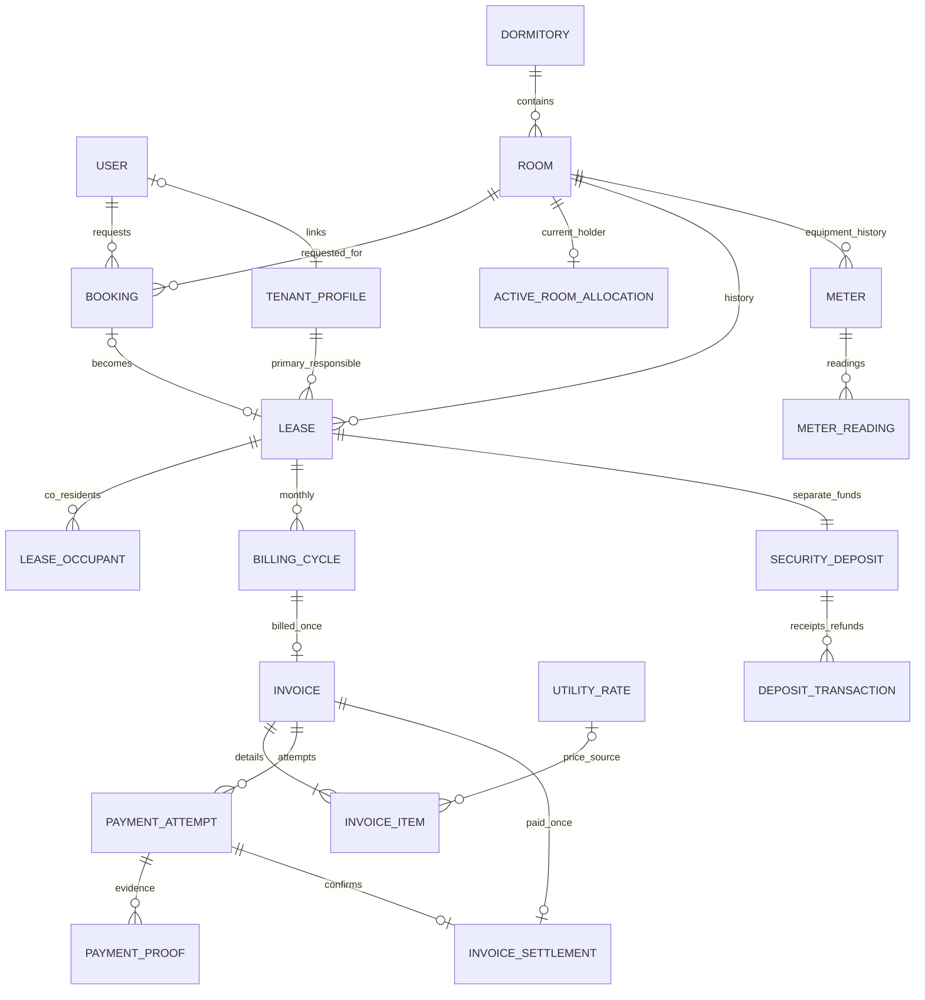
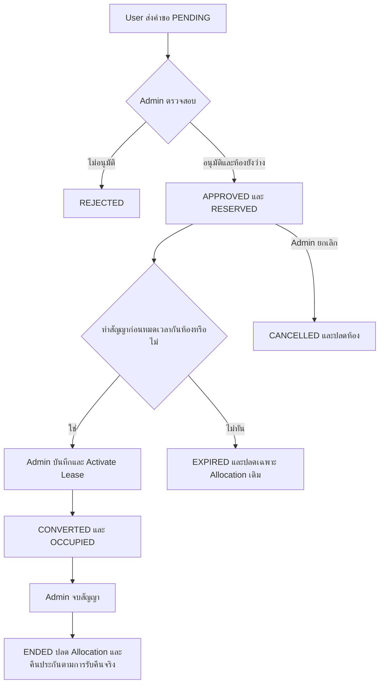

# DORMIFY — แบบข้อมูลและ Workflow ตาม Business Rules Phase 1

วันที่ 13 พฤศจิกายน 2569 (Asia/Bangkok) — เอกสารออกแบบเพื่อทบทวน ไม่ใช่ Schema ที่ติดตั้งแล้ว

## 1. ขอบเขตและสถานะการยืนยัน

กติกาต้นทางล่าสุดอยู่ใน [กติกาการทำงานของระบบ 14 ข้อ](../BUSINESS_RULES.md)
ผู้ใช้ระบุชัดว่าข้อ 3, 6 และ 9 ทั้งแนวทางยังรอเจ้าของหอยืนยัน ไม่ใช่รอยืนยันเฉพาะตัวเลข

อ้างอิงกติกา 14 ข้อจากคำสั่งผู้ใช้ล่าสุด ร่วมกับ PDF ที่มีจริง `docs/requirements/แบบเสนอโครงงานเอกอมร.pdf`
Hash ยังเป็น `3a86bc087da45df777f57bc34bb5215cfa191f09c0d6d3f850bcbfeac066ddd5` ตรงกับรอบวิเคราะห์ก่อน
ยังไม่มีหลักฐานว่าเป็นฉบับเดียวกับชื่อ `(1).pdf`; ข้อจำกัด Unicode/ภาพตารางอยู่ใน [ข้อความถอด PDF](PDF_TEXT_EXTRACTION.md)
ใช้ขอบเขต Admin 1.1–1.13 และ User 2.1–2.12 เดิม ไม่เพิ่ม Staff, เช่าแยกเตียง, Gateway, E-signature, ผ่อนชำระ หรือค่าปรับ

กติกาใหม่ใช้แทนข้อสงสัยเดิมด้านเช่าทั้งห้อง/จุดอนุมัติ/สูตรรอบบิลที่ระบุแล้ว แต่ไม่ถือว่าอนุมัติให้แก้โค้ด
ค่า 72 ชั่วโมง เงินประกัน 1 เดือน และ Due 5 วันเป็น **ค่าที่เสนอ ยังไม่ใช่ค่าที่เจ้าของหอยืนยัน**
การมี Fields รองรับไม่แปลว่าระบบจะเปิดใช้ค่าดังกล่าวอัตโนมัติ

| Rule | หลักที่ใช้ในการออกแบบ | สถานะ/ผลต่อข้อมูล |
|---|---|---|
| BR01 | เช่าทั้งห้อง มีผู้พักหลายคน ผู้รับผิดชอบหลักหนึ่งคน | ยืนยัน: Allocation ต่อ Room ไม่ต่อ Bed; Lease มี Primary tenant บังคับหนึ่งคน |
| BR02 | User ส่งคำขอ Admin ตรวจและอนุมัติ | ยืนยัน: User ไม่สามารถเปลี่ยนเป็น APPROVED เอง |
| BR03 | กันห้องหลังอนุมัติ ปรับระยะเวลาได้ เสนอ 72 ชม. | แนวทางรอยืนยัน: เก็บ Settings + Duration snapshot + expiresAt ต่อการอนุมัติ |
| BR04 | ทำสัญญาภายหลังนอกเว็บ Admin บันทึก | ยืนยัน: Booking ไม่ใช่ Lease; ไม่สร้างลายเซ็นออนไลน์ |
| BR05 | ค่าเช่ารายเดือน แยกตามห้องและตามสัญญา | ยืนยัน: Room.baseMonthlyRent และ Lease.monthlyRent แยกกัน |
| BR06 | เงินประกันเสนอ 1 เดือน แยกจากค่าเช่าและคืนเมื่อจบ | แนวทางทั้งข้อรอยืนยัน: ออกแบบ Deposit account/Transactions รองรับไว้; ไม่มีการริบ/หักหนี้อัตโนมัติ |
| BR07 | Admin กรอกมิเตอร์ Server คำนวณหน่วย/ยอด | ยืนยัน: เก็บ Reading ต้น/ปลายและอัตราที่ใช้จริง ไม่รับ Total ที่ Browser คำนวณเป็นความจริง |
| BR08 | กำหนดอัตราตามจริงและกฎหมาย | ยืนยันหลักการ: มีเวอร์ชัน/วันที่มีผล/ที่มาของอัตรา; สูตร/ตัวเลขจริงต้องตรวจอีกครั้ง |
| BR09 | ออกบิลตามวันเริ่มสัญญา เสนอ Due หลังออก 5 วัน | แนวทางทั้งข้อรอยืนยัน: ทั้งฐานรอบบิลและวันครบกำหนดยังต้องเจ้าของทบทวนก่อน Final schema |
| BR10 | วันที่ไม่มีในเดือนใช้วันสุดท้าย | ยืนยัน: คง Anchor day เดิม ไม่เลื่อน Anchor ตามเดือนสั้น |
| BR11 | เงินสด/โอน ผ่าน Admin ตรวจยืนยัน | ยืนยัน: CASH/TRANSFER; Upload ไม่เท่ากับ PAID |
| BR12 | ไม่แบ่งชำระ ไม่มีค่าปรับล่าช้า | ยืนยัน: หนึ่ง Settlement เต็มจำนวนต่อบิล ไม่คำนวณ Fine/Installment |
| BR13 | ไม่ออกบิลซ้ำ เก็บประวัติอัตราบิลเดิม | ยืนยัน: Invoice ผูก BillingCycle แบบ Unique และเก็บ Immutable snapshots |
| BR14 | ตรวจ Admin/User ทุกขั้นตอน | ยืนยัน: Backend Role + Ownership + State ในทุกการอ่าน/เขียน/ดาวน์โหลด |

เอกสารนี้อธิบายแบบเป้าหมายเพื่อไม่ให้ข้อมูลแต่ละ Phase ขัดกัน ไม่ใช่ให้สร้างระบบบิล/ซ่อมทั้งหมดใน Phase 1 ทันที
Phase 1 ควรตรึงคำศัพท์ สิทธิ์ ความสัมพันธ์ และ Migration plan แล้วจึงทำ Implementation ตามคำสั่งถัดไป

## 2. การตัดสินใจหลักและผลต่อ Schema เดิม

| เดิมใน server/prisma/schema.prisma | แบบเป้าหมายที่เสนอ | เหตุผล |
|---|---|---|
| User.role: ADMIN/OWNER/TENANT แบบ String | ADMIN/USER เท่านั้น | ไม่มี Staff/Owner role เป้าหมาย; Public สมัครได้เฉพาะ USER |
| Property หลายแห่ง มี ownerId | Dormitory หนึ่งแห่ง | ไม่เป็น Marketplace; เก็บข้อมูลหอโดย Admin |
| Room.capacity/isAvailable/price | ความจุประกอบ + baseMonthlyRent + serviceStatus และ Allocation | จำนวนคนไม่ใช่จำนวนหน่วยเช่า; Boolean เดียวอธิบาย Reserved/Occupied ไม่พอ |
| Booking มี start/end/totalAmount | คำขอเช่า มี Requested/Approved/Expires และ Policy snapshot | ยังไม่มีสัญญา/หนี้ค่าเช่าจากแค่ส่งคำขอ; ไม่กำหนดยอดชำระให้ Booking |
| ไม่มีทะเบียนผู้รับผิดชอบ/ผู้พักร่วม | TenantProfile, Lease.primaryTenantId, LeaseOccupant | หนึ่งผู้รับผิดชอบต่อสัญญา ผู้พักร่วมไม่ต้องเป็น Account |
| Payment ผูก Booking | PaymentAttempt ผูก Invoice; InvoiceSettlement ผูกการตรวจรับ | การจ่ายค่าเช่าตามบิลไม่ใช่ค่าจอง; รองรับส่งใหม่หลังหลักฐานถูกปฏิเสธแต่ไม่แบ่งชำระ |
| ไม่มีเงินประกัน | SecurityDeposit + DepositTransaction | รับ/คืนแยกจากรายได้และค่าใช้จ่ายดำเนินงาน |
| ไม่มีมิเตอร์/บิล | UtilityRate, Meter, MeterReading, BillingCycle, Invoice, InvoiceItem | คำนวณตามรอบสัญญา ตรวจย้อนและกันบิลซ้ำ |

ทุกชื่อใหม่เป็นข้อเสนอในเอกสาร ไม่ได้เพิ่ม Models หรือแก้ Role ในระบบที่รันอยู่

## 3. Entities และ Fields ที่ควรมี

ชนิดข้อมูลเป็นแนวคิดสำหรับ MySQL/Prisma ไม่ใช่ Prisma syntax ที่นำไป Apply ได้ทันที
ใช้ Integer IDs/FKs ตามแนวเดิม; เงินเสนอ Decimal(12,2), อัตราต่อหน่วย Decimal(12,6), หน่วยมิเตอร์ Decimal(14,3)
ต้องยืนยันความละเอียด/เพดานจากมิเตอร์และสูตรจริงก่อนตรึง Native types; ใช้ Decimal arithmetic ไม่ใช้ Float คิดยอดเงิน
เหตุการณ์เก็บ UTC DateTime; วันเริ่ม/สิ้นสุด/รอบบิล/วันครบกำหนดใช้ Date ตาม Asia/Bangkok ไม่ใช้วันที่แสดง พ.ศ. เป็นค่าฐาน

| Entity | Fields สำคัญที่เสนอ | ความสัมพันธ์/Constraints |
|---|---|---|
| User | id, emailNormalized, passwordHash, name, role, accountStatus | emailNormalized unique; Role ADMIN/USER เท่านั้น; ไม่รับ Role ที่ยกระดับจาก Client |
| TenantProfile | id, userId?, name, contactPhone?, contactAddress? | userId unique เมื่อผูก Account; ไม่ใช่ Role ใหม่; ข้อมูลผู้รับผิดชอบหลัก |
| Dormitory | id, name, address, contact, rules | หนึ่งหอ; ไม่ต้องมีหลาย Owner |
| Room | id, roomNumber, baseMonthlyRent, capacity?, serviceStatus | roomNumber unique ในหอนี้; serviceStatus AVAILABLE_FOR_USE/OUT_OF_SERVICE เป็นความพร้อมทางกายภาพ ไม่แทน Occupancy |
| Booking | id, roomId, requestedByUserId, intendedMoveInDate?, status, requestedAt, approvedBy?, approvedAt?, holdDurationHoursSnapshot?, holdExpiresAt?, expiredAt?, cancelledAt?, reason? | User/Room FKs; Snapshot ระยะเวลาจาก Policy ที่อนุมัติ; เก็บประวัติแม้หมดอายุ |
| ActiveRoomAllocation | roomId, bookingId?, leaseId?, kind | roomId PK; bookingId/leaseId unique เมื่อไม่ null; RESERVED มี Booking เท่านั้น OCCUPIED มี Lease เท่านั้น |
| Lease | id, contractNo, roomId, primaryTenantId, bookingId?, status, signedDate?, startDate, endDate?, monthlyRent, billingAnchorDay, paymentDueDaysSnapshot?, depositRequiredAmount, activatedAt?, endedAt? | contractNo unique; primaryTenantId NOT NULL อ้าง TenantProfile; bookingId unique เมื่อมี; Anchor จาก startDate |
| LeaseOccupant | id, leaseId, name, contactPhone?, movedInDate?, movedOutDate? | เป็นผู้พักร่วมที่ไม่ใช่ Primary; ไม่มี Bed price/สิทธิ์ Account อัตโนมัติ; Primary อยู่ Field เดียวของ Lease |
| RentalPolicy | id/version, holdDurationHours?, depositMonths?, paymentDueDays?, effectiveFrom, confirmedAt?, confirmedBy? | เก็บค่าที่อนุมัติแล้วและประวัติ; 72/1/5 เป็น Draft proposal ไม่เปิดใช้เอง |
| UtilityRate | id, utilityType, unitPrice, effectiveFrom, effectiveTo?, unit, calculationBasis, sourceReference, approvedBy | WATER/ELECTRICITY; version เป็น Record ใหม่ ไม่แก้ราคาเก่า; ห้ามช่วงใช้ทับกันในชุดอัตราเดียว |
| Meter | id, roomId, utilityType, serialNo?, installedAt, retiredAt?, initialReading | แยกอุปกรณ์จริงเพื่อไม่ตีความค่ามิเตอร์ใหม่ที่ลดลงว่าใช้ติดลบ |
| MeterReading | id, meterId, readingAt, value, enteredBy, enteredAt, note? | unique meterId+readingAt; ห้ามค่าติดลบ/ย้อนหลังผิดลำดับในมิเตอร์เดียว; บันทึกการแก้มีประวัติ |
| BillingCycle | id, leaseId, cycleIndex, periodStart, periodEndExclusive, scheduledIssueDate | unique leaseId+cycleIndex; unique leaseId+periodStart; periodStart < periodEndExclusive |
| Invoice | id, invoiceNo, billingCycleId, status, issuedAt?, deliveredAt?, dueDate?, dueDaysSnapshot?, totalAmount, tenantNameSnapshot, roomNumberSnapshot | invoiceNo unique; billingCycleId unique; บิลที่ออกแล้วเก็บตัวตน/ยอด ณ ตอนออก |
| InvoiceItem | id, invoiceId, itemType, description, quantity, unit, unitPriceSnapshot, amount, rateId?, openingReadingId?, closingReadingId?, readingStartSnapshot?, readingEndSnapshot?, calculationBasisSnapshot? | RENT/WATER/ELECTRICITY ตามขอบเขต; เก็บ Input และยอด ไม่คำนวณบิลเก่าจาก Room/Rate ล่าสุด |
| PaymentAttempt | id, invoiceId, submittedBy?, method, amount, paidOn, status, submittedAt, reviewedBy?, reviewedAt?, reason? | CASH/TRANSFER; PENDING/CONFIRMED/REJECTED; amount ต้องเท่า Invoice total ตอนยืนยัน; เงินสด Admin บันทึกได้โดยไม่ปลอมว่าผู้เช่า Submit |
| PaymentProof | id, paymentAttemptId, storageKey, mime, size, checksum, uploadedBy | หลักฐานส่วนตัว; ไม่คืน Public URL; สิทธิ์ผูกผู้รับผิดชอบ/Invoice |
| InvoiceSettlement | invoiceId, paymentAttemptId, confirmedAt, confirmedBy | invoiceId PK/unique; paymentAttemptId unique; ต้องเป็น Attempt ของ Invoice เดียวกัน; จึงชำระเต็มได้เพียงครั้งเดียว |
| SecurityDeposit | id, leaseId, requiredAmountSnapshot | leaseId unique; แยกยอดที่ต้องวางจากยอดรับจริง; ห้ามตีความ Required = Received |
| DepositTransaction | id, operationKey, securityDepositId, type, amount, method, occurredAt, recordedBy, reference?, reason? | operationKey unique กัน Retry; RECEIPT/REFUND; ยอดบวก; เงินสด/โอน; รับ/คืนจริงและ Audit; ยอดคืนไม่เกินคงเหลือภายใต้ Lock |
| AuditLog | actorId, action, entityType, entityId, occurredAt, safeChangeSummary | ทุกการอนุมัติ/ยกเลิก/หมดอายุ/สัญญา/อัตรา/บิล/เงิน มีหลักฐาน ไม่มี Secret/Proof ดิบ |

TenantProfile.userId อาจ nullable เพื่อรองรับทะเบียนผู้เช่าที่ Admin เพิ่มตาม PDF; การเปิดใช้กรณีไม่มี Account ต้องยืนยันวิธีผูกบัญชี
คำขอจากเว็บมี User เสมอ; เสนอให้ Primary ของ Lease ที่มาจาก Booking เป็น TenantProfile ที่ผูก User ผู้ขอเดิม
หากต้องเปลี่ยนผู้รับผิดชอบก่อนเซ็น ให้ยืนยันขั้นตอนก่อน ไม่ให้ Client ส่ง primaryTenantId ของคนอื่นแล้วได้สิทธิ์แทน
ไม่เพิ่ม Unique ต่อ User ที่บังคับว่าหนึ่งคนเช่าได้ห้องเดียว เพราะผู้ใช้ยังไม่ได้กำหนดข้อห้ามนี้
capacity เป็นข้อมูลเดิมที่ใช้บอกจำนวนพักได้ แต่เงื่อนไขบังคับจำนวนผู้พักต้องให้เจ้าของยืนยัน ไม่ตั้งเพดานเอง

แบบกระชับ: Invoice.totalAmount เสนอให้ > 0 เมื่อ ISSUED; ถ้าต้องรองรับบิลศูนย์ต้องกำหนดสถานะปิดบิลที่ไม่สร้าง Payment ปลอมก่อน
Lease.endDate จะบังคับมีวันสิ้นสุดหรือไม่ รวมสัญญาไม่กำหนดระยะเวลา ยังรอตกลงก่อน Final schema

## 4. ER Diagram แกนหลัก

Allocation ต้องมี FK ไป Booking หรือ Lease ตาม kind และต้องอยู่ห้องเดียวกัน ตรวจด้วย Composite FK/Constraint ที่รองรับหรือ Transaction validation ที่มี Tests
Settlement ต้องอ้าง Attempt ของ Invoice เดียวกัน เช่น Composite FK (paymentAttemptId, invoiceId) ไป Unique (id, invoiceId) ของ Attempt
ไม่อ้างว่า Prisma Enums/Relations อย่างเดียวรับประกัน Cross-row invariants ทุกข้อ; ให้ Review SQL ที่สร้างจริงในขั้น Implementation

## 5. Workflow ขอเช่า → กันห้อง → สัญญา

เสนอ Booking states: PENDING → APPROVED/REJECTED/CANCELLED; APPROVED → CONVERTED/EXPIRED/CANCELLED
CONVERTED/EXPIRED/REJECTED/CANCELLED เป็นปลายทาง ไม่ให้ Reapprove รายการหมดอายุโดยไม่มีกติกาใหม่
Lease: DRAFT → ACTIVE → ENDED; DRAFT ไม่ถือครองห้องเอง และการกดย้อนสถานะต้องไม่ทำให้ห้องเปิดว่างผิด
User ยืนยันที่หน้าเว็บหมายถึงส่งคำขอ ไม่ใช่อนุมัติหรือเซ็นสัญญา
สิทธิ์ User ยกเลิกคำขอ/นัดหมาย/ขยายเวลากันห้องยังไม่กำหนด จึงไม่ใส่ Endpoint เหล่านี้เป็นข้อที่อนุมัติแล้ว

### Transaction และป้องกันเช่าซ้ำ

ทุก Mutation ที่กระทบการครอบครอง Lock Room เดียวกันก่อน แล้วตรวจบัญชี/Role/Booking/State/Allocation ภายใน Transaction
ตอนอนุมัติสร้าง Allocation ที่ roomId unique พร้อม Update Booking และ Audit โดย Atomic
ถ้ามีคนถือสิทธิ์อื่นตอบ Conflict ไม่ Overwrite; Retry รายการเดิมที่ยังไม่หมดอายุตอบผลเดิมโดยไม่เลื่อน expiresAt
ตอน Activate ตรวจว่ามี Allocation ของ Booking นี้ และ now < holdExpiresAt แล้วเปลี่ยนเป็น Lease ใน Transaction เดียวโดยไม่ปล่อยว่างคั่นกลาง
การยกเลิก/หมดอายุต้องปลดด้วย roomId และ bookingId/leaseId ที่ตรงกัน ไม่ตั้ง Boolean ว่างโดยไม่ตรวจผู้ถือปัจจุบัน
คำขออื่นยัง PENDING ได้ก่อนมีการอนุมัติ แต่ไม่ถือสิทธิ์; เมื่อห้องถูกกันต้องแสดงสถานะจริงและปฏิเสธการอนุมัติซ้อน
นโยบายปิด/เก็บ PENDING ของคนอื่นเมื่อมีผู้ได้ห้องยังรอยืนยัน ไม่ทำการปฏิเสธทั้งหมดเองเงียบ ๆ

ถ้าใช้ 72 ชั่วโมง: expiresAt = approvedAt + holdDurationHoursSnapshot เป็นระยะเวลาจริง ไม่ใช่สามวันทำการ
เปลี่ยน Settings ภายหลังไม่แก้ระยะเวลารายการที่อนุมัติแล้ว; จะแก้ย้อนหลังต้องมีนโยบายและ Audit แยกก่อน
เสนอให้หมดอายุเมื่อ now >= expiresAt และ Activate ได้เฉพาะก่อนเส้นตาย กติกาขอบเขตนี้เป็นรายละเอียดทางเทคนิครอยืนยัน
Local ปิดเครื่องอาจไม่มี Worker ทำงาน จึงไม่พึ่ง Timer ใน Browser หรือ cron เพียงอย่างเดียว
เมื่อเปิด Server/เข้าดูห้อง/พยายามอนุมัติหรือ Activate ต้องตรวจ Expiry ด้วยเวลาฝั่ง Server และ reconcile ใน Transaction ก่อนตัดสิน
Worker เป็นตัวช่วย ไม่ใช่หลักประกันความถูกต้อง; expiredAt ที่บันทึกและ scheduled expiry แยกจากเวลาที่ระบบกลับมาประมวลผล
ห้ามให้ Expiry กับ Activate ต่างฝ่ายต่าง Commit ได้; ทั้งคู่ต้องใช้ Lock/State guard เดียวกัน

การ Lock อ่านแล้วเปลี่ยนข้อมูลใน Transaction อ้างแนวคิดจาก [MySQL 8.4 InnoDB locking reads](https://dev.mysql.com/doc/refman/8.4/en/innodb-locking-reads.html)
ต้องยืนยัน MySQL/Prisma รุ่นจริงก่อนเลือก Parameterized SQL/Lock API ไม่มีการรันคำสั่งเหล่านี้ในงานนี้

## 6. รอบบิลรายเดือนและหน่วยน้ำไฟ

เสนอสูตรปฏิทินให้ `anchorDay = วันของ Lease.startDate` แล้วหาวันของแต่ละเดือนจาก startDate ต้นฉบับเสมอ
วันที่ในเดือนเป้าหมาย = min(anchorDay, จำนวนวันเดือนนั้น); อย่าเอาวันที่ที่ถูกปรับของรอบก่อนมาเป็น Anchor ใหม่
ใช้ cycleIndex ที่เริ่ม 0 และ Date boundaries แบบ [periodStart, periodEndExclusive) เพื่อไม่คิดวันซ้ำระหว่างรอบ
scheduledIssueDate เป็นวันตามแผน ส่วน issuedAt เป็นเวลาที่ออก/เผยแพร่จริง ไม่ Backdate เพื่อให้ดูว่ารันตรงรอบ

ตัวอย่างคำนวณด้วยกติกาเสนอ (ไม่ใช่ผลทดสอบโค้ด):

| เริ่มสัญญา | วันออกบิลตาม Anchor ในแต่ละเดือน | ข้อสังเกต |
|---|---|---|
| 31 ม.ค. 2570 | 31 ม.ค. → 28 ก.พ. → 31 มี.ค. → 30 เม.ย. | เดือนสั้นไม่ทำให้เดือนต่อไปกลายเป็นวันที่ 28 |
| 30 ม.ค. 2570 | 30 ม.ค. → 28 ก.พ. → 30 มี.ค. | ยึดวันที่ 30 เดิม |
| 29 ม.ค. 2571 | 29 ม.ค. → 29 ก.พ. → 29 มี.ค. | รองรับ Leap year ตามปฏิทิน ค.ศ. |

หากอนุมัติ Due 5 วัน เสนอให้นับวันปฏิทินหลังวันออกบิลจริงใน Bangkok: ออก 28 ก.พ. 2570 → dueDate 5 มี.ค. 2570
ตัวอย่างนี้ไม่กำหนดเวลา Cutoff ของวันครบกำหนด และไม่เพิ่มวันทำการ/เลื่อนวันหยุดโดยผู้ใช้ยังไม่ได้สั่ง
เก็บ dueDaysSnapshot/dueDate บน Invoice เพื่อไม่เปลี่ยนเมื่อ Default เปลี่ยน
ต้องบันทึก deliveredAt หรือหลักฐานการแจ้งในระบบแยกจาก createdAt; ออกบิลไม่เท่ากับส่งถึงผู้เช่าเสมอ
บิลล่าช้าเพราะ Local ปิดต้องเก็บ scheduledIssueDate/issuedAt จริงและให้ Admin ตรวจ Missing cycles ไม่สร้างย้อนหลังเงียบ ๆ

ยังต้องตกลงว่าค่าเช่าบิลรอบเริ่มต้นเป็นชำระล่วงหน้าหรือย้อนหลัง และค่าน้ำไฟบิลนั้นเป็นช่วงก่อนหน้าหรือช่วงเดียวกัน
ช่วงมิเตอร์ต้องมี Reading ที่ครอบคลุมช่วงใช้จริง ไม่เอายอดเดือนปฏิทินมาปนกับรอบสัญญาวันที่ 15/31 โดยไม่กำหนดนโยบาย
หากยังไม่มีเลขต้น/ปลายครบให้ค้าง Draft/แจ้ง Admin ไม่ใช้ 0 แทนเลขที่หายและไม่ออกบิลน้ำไฟต่ำกว่าจริงโดยเงียบ ๆ
กรณีเปลี่ยนมิเตอร์ให้แยก Meter และช่วงของแต่ละอุปกรณ์ ไม่ลบ Reading เก่าหรือนำปลายใหม่ลบต้นเก่าจนติดลบ
การเปลี่ยนอัตรากลางช่วงต้องยืนยันใช้วันที่ใด/แบ่งช่วงอย่างไร ถ้าต้องแบ่งต้องมีข้อมูลรองรับ ไม่เฉลี่ยหรือประมาณหน่วยเอง

สูตรพื้นฐาน: usedUnits = closingReading − openingReading; lineAmount = usedUnits × authorizedUnitPrice แล้วปัดเศษตามกติกาที่ตกลง
RENT ใช้ Lease.monthlyRent ไม่ใช้ Room.baseMonthlyRent ล่าสุด; รวม Line amounts ที่ปัดแล้วเป็น Invoice total ตามมาตรฐานเดียว
หลักการไม่แบ่งชำระ/ไม่มีค่าปรับเป็นข้อยืนยัน จึงไม่มี Installment schedule, Fine line หรือ Late-fee Job
สามารถแสดงสถานะเกิน Due จากวันที่ได้โดยไม่เพิ่มยอดหนี้

### กันบิลซ้ำและเก็บประวัติ

BillingCycle unique leaseId+cycleIndex และ Invoice.billingCycleId unique เป็นหลักประกันที่ DB ร่วมกับ Transaction/Idempotency
ค่า Index ไม่เปลี่ยนเพราะแก้ Settings; ตรึง Anchor ของ Lease Active และอย่าให้เปลี่ยนจนสร้างรอบทับกัน
Generate ซ้ำ/กดพร้อมกันต้องได้ Invoice เดิมหรือ Conflict ที่ชัด ไม่สร้างบิลใหม่ของรอบเดิม
Invoice ISSUED เก็บ Description, Unit, Rate, Reading, Rent, Total, Policy ที่ใช้เป็น Snapshot
อัตราหรือค่าเช่าห้องใหม่ไม่แก้บิลเก่า; การแก้ Reading ที่บิลอ้างแล้วห้ามเปลี่ยน Historical amount
เสนอแก้รายละเอียดได้ก่อน Issue เท่านั้น หลัง Issue ต้องกำหนด Correction policy ก่อนทำ ไม่สร้าง Credit note/บิลเสริม/การออกใหม่หลัง Void นอกขอบเขตเอง

## 7. ชำระเต็มจำนวนและเงินประกัน

### บิลค่าเช่า/น้ำไฟ

TRANSFER: User ส่งยอดเต็มพร้อมหลักฐาน → PENDING → Admin ตรวจ → CONFIRMED หรือ REJECTED พร้อมเหตุผล
CASH: Admin รับเงินจริง บันทึกยอด/วันที่/ผู้รับ และตรวจยืนยัน; User ไม่มีสิทธิ์ยืนยันว่าเงินสดรับแล้ว
หลักฐานเป็นเอกสารประกอบ ไม่ใช่หลักฐานอัตโนมัติว่ารับเงินสำเร็จ
ก่อน Confirm ให้ Lock Invoice ตรวจ Role/Ownership/State/amount == totalAmount และยังไม่มี Settlement แล้วสร้าง Settlement + Audit และเปลี่ยนเป็น PAID พร้อมกัน
PaymentAttempt หลายรายการรองรับส่งหลักฐานใหม่หลังถูกปฏิเสธ ไม่ใช่หลายงวดชำระ
ถ้ายืนยันแล้ว Retry Attempt เดิมตอบผลเดิม; Attempt อื่นห้ามยืนยันซ้ำ ต้องตอบว่า Invoice จ่ายแล้ว
ไม่ใช้ Unique(invoiceId,status) เพราะทำให้มีประวัติ REJECTED หลายครั้งไม่ได้ และไม่ได้อธิบาย State transitions ครบ
หากยอดน้อย/มากกว่าบิลให้ Admin ตรวจและปฏิเสธตามกติกา ไม่บันทึกเป็นแบ่งชำระ/เครดิต/หักประกันเอง
กรณีรับเงินจริงผิดยอด/คืนเงินค่าเช่าผิดพลาดยังไม่อยู่ในกติกา ต้องตกลงก่อนเพิ่ม Workflow นั้น

### เงินประกัน

เสนอเริ่มจาก requiredAmount = Lease.monthlyRent × depositMonthsProposal แต่บันทึกยอดจริงในสัญญาหลังยืนยัน ไม่ผูกตาม Room price ในอนาคต
SecurityDeposit แสดง Required; DepositTransaction RECEIPT แสดงรับจริง และ REFUND แสดงคืนจริงเมื่อจบสัญญา
Outstanding deposit balance = ยอดรับจริง − ยอดคืนจริง; คืนไม่ได้เกินที่รับจริง และห้ามคงเหลือติดลบ
เสนอรับ/คืนเต็มยอดเป็นการดำเนินการปกติ ไม่มี Deposit installment plan; ขอบเขตการคืนบางส่วน/หักความเสียหายยังไม่อนุมัติ
ไม่เรียกเก็บเงินประกันตอนแค่ Booking Approved และไม่ทำค่า Hold fee เพราะผู้ใช้ไม่ได้กำหนด
ยังไม่กำหนดว่าจ่ายเงินประกันครบเป็นเงื่อนไข Activate Lease หรือไม่ ให้ยืนยันก่อนใส่ Hard gate
เมื่อ Lease ENDED ให้มีรายการต้องดำเนินการคืนประกัน แต่ห้ามสร้าง REFUND ว่าโอนแล้วโดยอัตโนมัติ

รายงาน PDF 1.11 ต้องแยก:
- รายรับค่าเช่า/น้ำไฟที่ Confirm แล้ว
- รายจ่ายดำเนินงานจาก Expense
- รับเงินประกัน/คืนเงินประกันและยอดคงเหลือ เป็นหมวดเงินถือไว้แยก ไม่รวมเป็นรายรับค่าเช่าหรือรายจ่ายดำเนินงานซ้ำ

นี่เป็นการจัดข้อมูลรายงานโครงงาน ไม่ใช่การเพิ่มระบบบัญชีแยกประเภทเต็มรูปแบบหรือสรุปวิธีรับรู้รายได้ทางภาษี

## 8. อัตราตามกฎหมายและขอบเขตที่ยังไม่รับรอง

ไม่ใส่อัตราน้ำไฟตายตัวใน Schema/Seed; หน้าตั้งค่าต้องระบุที่มา วันที่ใช้ และวิธีคำนวณที่เจ้าของตรวจแล้ว
การปรับค่าได้ไม่แปลว่า Admin ใส่ตัวเลขเท่าใดก็ถูกกฎหมาย; ต้องยืนยันประเภทกิจการ/การบังคับใช้และเอกสารผู้ให้บริการจริงก่อนเปิดคิดเงินจริง
แหล่งอ้างอิงทางการที่ตรวจ: [สคบ. เรื่องแบบสัญญามาตรฐานและประกาศ พ.ศ. 2568](https://www.ocpb.go.th/news_view_plan.php?nid=17943)
และ [ตัวอย่างสัญญามาตรฐาน แบบ ก](https://www.ocpb.go.th/article_attach/articlefile_2026060814431516244.pdf)
ตัวอย่างนี้มีประเด็นการแจ้งบิลล่วงหน้าและคืนเงินประกันที่ต้องตรวจว่าบังคับกับกิจการนี้หรือไม่ ไม่ใช้เป็นการรับรองค่าเสนอ 72 ชั่วโมง/1 เดือน/5 วัน
ยังไม่ได้ตรวจประกาศฉบับเต็มทุกหน้า เนื่องจากเครื่องมือเปิดไฟล์แนบประกาศขนาดใหญ่ไม่ได้ และยังไม่ทราบประเภททะเบียน/จำนวนหน่วยของกิจการ
ดังนั้นไม่สรุปตัวเลขเพดาน อัตราที่เรียกเก็บได้ หรือกำหนดเวลาคืนที่ใช้บังคับเฉพาะหอนี้จากการออกแบบฐานข้อมูล
ไม่คัดลอกสูตรตัวเลขจากตัวอย่างสัญญาไปคำนวณโดยไม่ตรวจหน่วย/ผู้ให้บริการ และไม่เพิ่มภาษี/ค่าบริการอื่นตามแบบตัวอย่างโดยพลการ

## 9. Permission Matrix

ทุกคำขอตรวจ Session/Token ที่ Server, สถานะ Account, Role, Entity ownership และ Workflow state
User ID/role/Invoice owner ที่ส่งใน Body หรือ localStorage ไม่เป็นแหล่งความจริง

| การทำงาน | Public | USER | ADMIN |
|---|---|---|---|
| ดูข้อมูลหอ/ห้อง/ราคา/สถานะ Public DTO | ได้ ไม่เปิดชื่อผู้พัก/สัญญา | ได้ | ได้ |
| สมัคร Account | ได้เป็น USER เท่านั้น | ไม่ยกระดับสิทธิ์ | สร้าง/จัดการผู้เช่าตามขอบเขต PDF |
| ส่ง/ดู Booking | ไม่ได้ | ส่งในนามตน/ดูของตน | ตรวจและดูทั้งหมด |
| อนุมัติ/หมดอายุ/ปลด Allocation | ไม่ได้ | ไม่ได้ | Admin action หรือระบบตาม Policy ที่อนุมัติ; Audit ทุกครั้ง |
| ผู้พักร่วม/ข้อมูลผู้เช่า | ไม่ได้ | ดูเฉพาะข้อมูลสัญญาตนเท่าที่จำเป็น | เพิ่ม/แก้ตามอำนาจและ Audit |
| บันทึก/Activate/End Lease | ไม่ได้ | ดูเฉพาะของตน | ได้ภายใต้ State/Allocation |
| ตั้งอัตรา/กรอกมิเตอร์/ออกบิล | ไม่ได้ | อ่านบิลตนและรายละเอียดที่จำเป็น | ได้ตาม Policy/Validation |
| แจ้งโอน/อัปโหลดหลักฐาน | ไม่ได้ | บิลของผู้รับผิดชอบที่ผูก Account ตน | บันทึก/ตรวจหลักฐานหรือรับเงินสดตามจริง |
| Confirm Payment/Deposit receipt/refund | ไม่ได้ | ไม่ได้ | ได้ พร้อมการตรวจยอดและ Audit |
| ดาวน์โหลดหลักฐาน | ไม่ได้ | หลักฐานที่มีสิทธิ์ตาม Invoice ของตน | ได้ตามหน้าที่ ไม่เปิด URL สาธารณะ |
| Report/Audit/ภาพรวม | ไม่ได้ | ไม่มีสิทธิ์ดูของผู้อื่น | ได้; User มีเพียงข้อมูล/ประวัติตนตาม PDF |

ผู้พักร่วมที่ไม่มีบัญชีไม่สามารถ Login ด้วยชื่อใน LeaseOccupant และไม่ได้สิทธิ์ดูสัญญา/การเงินอัตโนมัติ
ถ้าต้องการให้ผู้พักร่วมใช้ Account และเห็นข้อมูลห้อง ต้องออกนโยบายเพิ่มก่อน ไม่เปิดเพราะพักอยู่ห้องเดียวกันอย่างเดียว
404/403 ต้องออกแบบไม่ให้เดาแล้วเห็นชื่อ/ไฟล์คนอื่น; เปลี่ยน ID ใน URL/Body ต้องไม่ข้าม Ownership

## 10. ฟีเจอร์ PDF ที่ยังคงอยู่และไม่ถูกขยาย

คง MaintenanceRequest, Expense, Announcement/Notification และ AuditLog ตาม [RTM 25 ข้อ](REQUIREMENTS_TRACEABILITY_MATRIX.md)
Maintenance ผูกผู้แจ้ง/ห้อง/Lease context; ไม่เพิ่มช่างหรือ Staff Role
Report อ่าน Invoice/Settlement/Expense/Deposit แยกหมวด; Dashboard ไม่ใช้ยอด Pending เป็นเงินรับแล้ว
Notifications ในเว็บอ้าง Booking/Invoice/Payment/ซ่อมที่มีสิทธิ์; ยังไม่เพิ่ม SMS/Email/LINE
ชื่อ Models ที่แตกย่อย เช่น Allocation/Settlement/BillingCycle เป็นกลไกรักษาความถูกต้องของฟีเจอร์เดิม ไม่ใช่ฟีเจอร์ผู้ใช้ใหม่

## 11. ประเด็นที่ยังต้องยืนยันก่อน Final Schema

| ID | ประเด็นที่ต้องตัดสินใจ | สิ่งที่ยังไม่ใส่เป็นกฎบังคับ |
|---|---|---|
| P01 | เจ้าของยืนยันระยะกันห้อง 72 ชั่วโมง/วิธีเปลี่ยน Default | ไม่ใส่ค่าอนุมัติแล้ว และไม่เพิ่มขยายเวลาอัตโนมัติ |
| P02 | เงินประกัน 1 เดือน/จุดรับเงิน/เงื่อนไขเปิดสัญญา/วิธีคืน | ไม่ริบ ไม่หักบิล/ความเสียหาย ไม่โอนคืนอัตโนมัติ |
| P03 | Due 5 วันนับวันปฏิทินและเวลาตัดยอด/การส่งแจ้งบิล | ไม่ใส่ Fine และไม่ยืนยันการสอดคล้องกฎหมายแทนเจ้าของ |
| P04 | ค่าเช่ารอบแรกคิดล่วงหน้าหรือย้อนหลัง น้ำไฟสัมพันธ์รอบใด | ไม่ประเมินมิเตอร์/Prorate/ใช้ศูนย์แทนข้อมูลหาย |
| P05 | อัตราจริง/วิธีคำนวณตามผู้ให้บริการ และเปลี่ยนอัตรากลางรอบ | ไม่กำหนดตัวเลขอัตราหรือวิธีเฉลี่ยเอง |
| P06 | สัญญามี endDate บังคับหรือไม่/ย้ายกลางเดือน | ไม่ใส่สูตรตัดรอบสุดท้าย/คืนค่าเช่าเอง |
| P07 | บัญชีผู้รับผิดชอบกับผู้เช่าที่ Admin เพิ่ม/ข้อจำกัดจำนวนคน | ไม่เปิดสิทธิ์ผู้พักร่วมและไม่กำหนด Maximum ที่ยังไม่ตกลง |
| P08 | วิธีแก้บิลที่ออกแล้ว/เงินที่ Verify ผิด/บิลศูนย์ | ไม่สร้าง Credit note/Refund ค่าเช่าหรือบิลรอบเดิมซ้ำ |
| P09 | User ยกเลิกเองได้หรือไม่ และจัดการ PENDING ของคนอื่น | ไม่เพิ่มสิทธิ์ Cancel/ขยายเวลาเอง |

ประเด็นเหล่านี้ไม่ขัดหลัก 14 ข้อ แต่เป็นช่องว่างที่ต้องปิดก่อนทำ Workflow ให้ครบและคิดเงินจริง

## 12. กรณีทดสอบที่ต้องมีในขั้น Implementation

ตารางนี้เป็น **แผนทดสอบ ยังไม่ได้รัน** และไม่มีข้อมูลจำลองถูกสร้างในงานนี้

| Test | กรณี | Expected |
|---|---|---|
| T01 | User ส่ง Role/Owner IDs อื่น/เรียก Admin API | ปฏิเสธ ไม่มีข้อมูลถูกเปลี่ยน |
| T02 | Admin สองคน Approve ห้องเดียวพร้อมกัน | ได้ Allocation เดียว อีกคำขอ Conflict ไม่มี Double booking |
| T03 | Retry Approve เดิม | ผลเดิม ไม่ต่อเวลา Hold |
| T04 | Activate พร้อม Expire และตรงเส้นตาย | Commit ได้เพียงทางเดียวตามนโยบาย now/expiresAt |
| T05 | ปิด Local เกิน Hold แล้วเปิดใหม่ | ไม่ Activate รายการหมดอายุ; Reconcile ปลดเฉพาะรายการเดิม |
| T06 | End/Cancel รายการเก่าหลังห้องมีผู้ถือใหม่ | ไม่ปลดห้องของผู้ถือใหม่ |
| T07 | ผู้พักร่วมหลายคน | ผู้รับผิดชอบหลักมีคนเดียว ไม่มีค่าเช่าแยกเตียง/สิทธิ์เพิ่ม |
| T08 | Anchor 29/30/31 เดือนสั้น/Leap year/ข้ามปี | กลับ Anchor เดิมเดือนถัดไป ช่วงไม่ซ้ำ |
| T09 | Generate Invoice ซ้ำ/พร้อมกัน | บิลเดียวต่อ Cycle |
| T10 | เปลี่ยนราคา Room/Rate/Default หลังออกบิล | บิลเก่า/Lease rent/Expiry/Due เดิมไม่เปลี่ยน |
| T11 | Reading หาย/ลดลง/เปลี่ยนมิเตอร์ | ไม่คิดยอดผิด/ติดลบ ไม่ใช้ศูนย์แทนค่าที่ขาด |
| T12 | User อัปโหลดไฟล์ปลอม/เกินขนาด/Proof ของคนอื่น | ปฏิเสธอย่างปลอดภัย และไม่เปิด Public link |
| T13 | โอน/เงินสดเต็มยอด และยอดต่ำ/สูงกว่าบิล | Confirm เฉพาะยอดเต็มตามกติกา ผู้ยืนยันเป็น Admin |
| T14 | Confirm ซ้ำหรือสอง Attempt พร้อมกัน | มี Settlement เดียว ไม่เป็นรายรับซ้ำ |
| T15 | เงินประกันรับ/คืน/คืนเกิน และ Retry | ยอดรับ/คืนถูกต้อง ไม่ติดลบ ไม่รวมเป็นรายรับค่าเช่า |
| T16 | เกิน Due | เห็นค้างชำระตามกติกา แต่ไม่มีค่าปรับ/แบ่งงวด |
| T17 | เปลี่ยน URL ID/Profile/Lease/Invoice/Proof | User เห็นเฉพาะข้อมูลที่มีสิทธิ์ |
| T18 | Report กับข้อมูลเงินจริง | Rental receipts/Expense/Deposit แยกและกระทบยอดได้ |

ต้องทดสอบบน MySQL จริงโดยเฉพาะ Lock/Unique/Transaction; ผล SQLite Phase 0 ไม่แทนการยืนยันแบบใหม่นี้

## 13. ขั้นถัดไปที่เสนอ

ทบทวน P01–P09 กับเจ้าของหอ โดยใช้กรณีวันเริ่ม 31/รอบแรก/มิเตอร์หาย/คืนประกันเป็นตัวอย่าง
จากนั้นตรึง Data Dictionary และ State/Permission Matrix แล้วจึงเขียน Prisma Schema MySQL ฉบับตรวจทานเมื่อได้รับคำสั่ง
ยังไม่สร้าง migrations ไม่สลับ DATABASE_URL ไม่ติดตั้ง MySQL/Dependencies และไม่แก้ Runtime code ในงานรอบนี้
